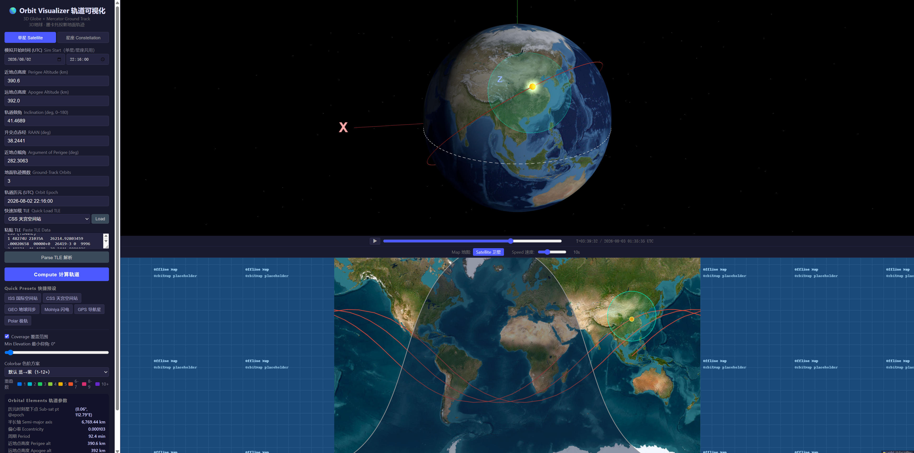
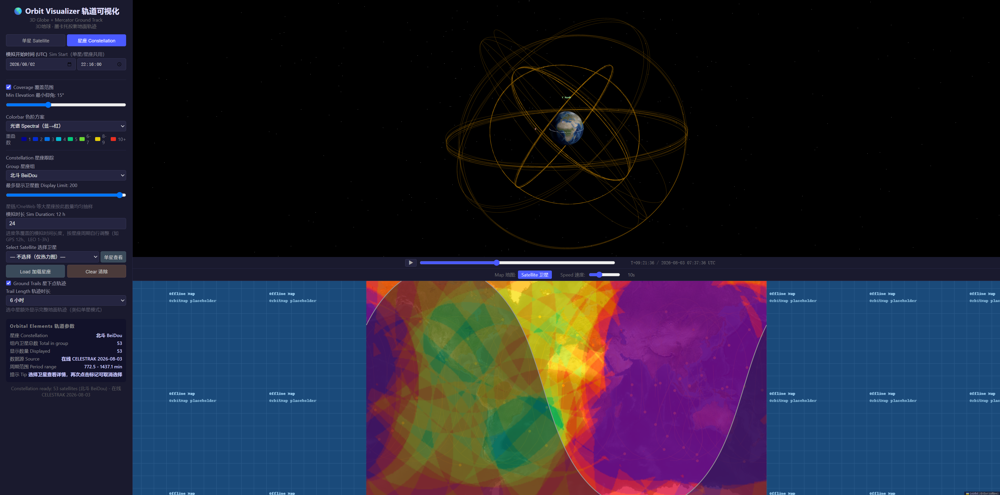

<div align="center">

# 🛰️ OrbitMap — Satellite Orbit Visualization Tool

Interactive spacecraft orbit visualization: **3D Earth orbit animation + 2D Mercator ground tracks**, with TLE loading, a real-time day/night terminator and satellite coverage (footprint) rendering.

[](LICENSE)


[简体中文](README.md) | **English**

</div>

---

## 📸 Screenshots





---

## ✨ Features

| Module | Description |
|---|---|
| 🪐 3D orbit animation | Three.js renders the ECI inertial orbit tube, satellite marker, ground projection point, equator ring, axes and star field; play/pause, progress scrubbing and speed control |
| 🗺️ 2D ground track | Leaflet Mercator multi-orbit ground tracks + real-time satellite marker; offline map tiles (Esri satellite / OSM) |
| 🌗 Day/night terminator | Computes the terminator great circle from the Sun position, fills the night hemisphere semi-transparently and updates in real time with Earth rotation; polar day/night and antimeridian cases are handled correctly |
| 📡 Coverage footprint | Computes the spherical cap from orbit altitude and minimum elevation: 2D fill + 3D surface ring and satellite cone; **pole and antimeridian cases are clipped correctly by d3-geo** |
| 🛰️ TLE support | Quick load (ISS / Tiangong / Hubble / NOAA 19 / GPS) or paste a two-line TLE for automatic parsing, with mean anomaly propagated over time; custom epoch and simulation start time |
| 🛸 Constellation tracking | Load and track GPS / BeiDou / weather (Fengyun) / Starlink / Iridium NEXT / Galileo / GLONASS / OneWeb constellations, online real-time TLE first with a local preset fallback; satellite count limit, dropdown selection, hand-off to single-satellite mode, ground trails and coverage heatmap |
| 🧮 Orbit computation | Kepler equation solver, 3-1-3 Euler rotation ECI transform, Earth-rotation-included ground track, perigee/apogee/period orbital elements |
| 📴 Fully offline | Leaflet / Three.js / earth texture / d3 all vendored under `static/vendor/`; missing map tiles fall back to a placeholder; **only live TLE fetching (single-satellite / constellation) requires the internet** |

## 🚀 Quick Start

```bash
pip install -r requirements.txt
python app.py          # opens http://127.0.0.1:5000 automatically
```

Requires Python 3.8+. On Windows you can simply double-click `start.bat`: it auto-detects the `python`/`py` launcher and installs missing dependencies on first run. No internet is required to run — all frontend libraries are vendored locally and missing map tiles automatically fall back to an offline placeholder.

### Map tiles (optional, requires internet once)

```bash
python scripts/download_esri_tiles.py   # Esri satellite tiles zoom 0-5 (~1365 tiles)
python scripts/download_tiles.py        # OSM tiles zoom 0-3
```

The tile directory (`static/tiles/`) is excluded via `.gitignore` because of its size. When offline or before downloading, the page uses `static/placeholder.png`; you can also run `python scripts/generate_tiles.py` to generate placeholder grid tiles.

### Constellation tracking

Switch between **Single Satellite / Constellation** modes at the top of the sidebar (mutually exclusive; constellation data is cached, so switching back does not re-fetch). In the **Constellation** panel:

1. Choose a group (GPS / BeiDou / weather / Starlink / Iridium NEXT / Galileo / GLONASS / OneWeb) and the "Display Limit" (very large groups such as Starlink are evenly sampled to avoid rendering thousands of satellites);
2. Click **Load**: it first fetches live TLE from CELESTRAK (requires internet); on failure or offline it automatically falls back to the bundled snapshot (`static/data/constellation_presets.json`) and shows the data source and update time in the results panel;
3. The 3D view shows each satellite's orbit ring and live position; the 2D map shows markers and ground trails. **Trail Length** can be set to 10 min / 30 min / 1 h / 3 h / 6 h / full simulation duration (default 1 h, 120 sample points, throttled updates). When a satellite is selected, its trail and full multi-orbit ground track (single-satellite style) are highlighted in yellow;
4. Use the **satellite dropdown** or click a 2D marker to highlight a satellite and view its orbital elements. Nothing is selected by default (heatmap only); click the selected marker again or pick "None (heatmap only)" to deselect;
5. Click **View as Single** to load the selected satellite into single-satellite mode (form, orbit and results update automatically, including the satellite name);
6. Enable **Coverage**: the 2D map renders an overlap heatmap for all displayed satellites (no selection needed), colored by overlap count — 1 blue / 2 cyan / 3 green / 4 lime / 5 orange / 6-7 orange-red / 8-9 red-magenta / 10+ deep violet, so dense GNSS regions with a dozen overlapping satellites can be distinguished. When a satellite is selected, its 3D cone/ring and 2D exact outline are also shown. The **Colorbar** dropdown switches color schemes: default (blue→violet), Spectral, Warm, Cool, Viridis, Rainbow, Grayscale — applied instantly with a live legend;
7. Changing the shared **Sim Start** time recomputes the constellation for the new epoch;
8. **Sim Duration (hours)** controls how much simulated time the progress bar spans (0.5-168 h; adjust to the constellation period, e.g. GPS 12 h, LEO 1-3 h). Changes apply instantly without recomputation;
9. Click **Clear** to return to single-satellite mode.

Refresh the bundled preset snapshot at any time (requires internet once):

```bash
python scripts/fetch_constellation_presets.py
```

## 🔌 API

| Endpoint | Method | Description |
|---|---|---|
| `/api/compute` | POST | Inputs `perigee`/`apogee`/`inclination`/`raan`/`arg_perigee`/`num_orbits`/`mean_anomaly` (km, degrees); returns orbital elements, 3D orbit coordinates and segmented ground track (JSON) |
| `/api/compute-constellation` | POST | Batch-computes constellation orbits: `satellites` array (each item with `name` and orbital parameters); returns per-satellite orbit rings, multi-orbit animation coordinates and elements |
| `/api/fetch-tle` | GET | Proxies TLE from CELESTRAK by NORAD ID (`?catnr=25544`) or group (`?group=gps-ops`) to avoid CORS issues |

## 📁 Project Structure

```
app.py                      Flask backend (API + page)
orbit_calc.py               Orbit computation core (Kepler, ECI/ECEF, ground track)
templates/index.html        Single-page frontend (Three.js 3D + Leaflet 2D + d3-geo SVG overlay)
static/
  vendor/
    leaflet/                Leaflet JS/CSS/icons (vendored)
    three/                  Three.js modules and OrbitControls (vendored)
    textures/               Earth texture (vendored)
    d3-array.min.js         d3-array (vendored)
    d3-geo.min.js           d3-geo (vendored)
  data/                     Constellation preset snapshot (constellation_presets.json)
  tiles/                    Offline map tiles (esri / osm)
  placeholder.png           Offline map fallback tile
docs/
  screenshots/              Run screenshots
scripts/                    Utility scripts
  download_esri_tiles.py    Esri satellite tile downloader
  download_tiles.py         OSM tile downloader
  generate_tiles.py         Placeholder/fallback tile generator
  fetch_constellation_presets.py  Fetch CELESTRAK constellation TLEs into the local preset
start.bat                   Windows launcher
```

## 🛠️ Technical Notes

- **2D overlay rendering**: the night hemisphere and coverage caps are rendered as spherical GeoJSON polygons through `d3.geoPath` — d3-geo's built-in antimeridian/pole spherical clipping splits cross-dateline and polar scenes into correct subpaths. The projection layer is aligned to Leaflet's pixel coordinates with `L.CRS.EPSG3857.latLngToPoint` (floating point, no rounding)
- **Physics model**: two-body problem, circular/elliptical orbits; `MU = 398600.4418 km³/s²`, `R_EARTH = 6378.137 km`, `OMEGA_E = 7.2921159e-5 rad/s`; latitude is geocentric (not geodetic), a slight approximation
- **Offline strategy**: the page references no CDN; Leaflet, Three.js, OrbitControls, the earth texture and d3 all live in `static/vendor/`; missing map tiles fall back to `static/placeholder.png` via `errorTileUrl`. Only live TLE fetching (`/api/fetch-tle`) depends on the internet, and the constellation falls back to the local preset snapshot when it fails
- **Constellation implementation**: the frontend parses multi-satellite TLE and propagates mean anomaly to the simulation start; the backend batch-computes ECI animation arrays, and the animation interpolates each satellite by its own period modulo, all synchronized in 2D/3D by Earth rotation (GST)
- **Development tip**: Flask caches templates when `debug=False`; after editing `templates/index.html`, restart with `python app.py`

## 📄 License

[MIT License](LICENSE) © 2026 Helium

Map tile copyright belongs to the respective data providers (Esri / OpenStreetMap); for study and research only.
